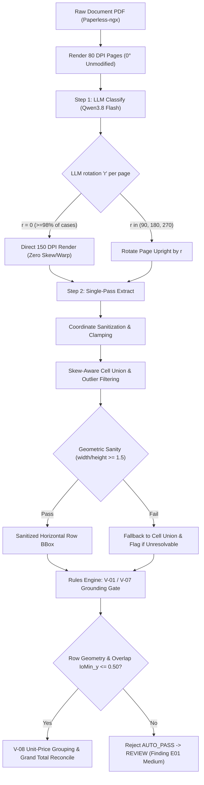

# Design: LLM-Driven Orientation Detection, Line BBox Sanitization & AUTO_PASS Integrity Safeguards

**Date:** 2026-10-15  
**Topic:** Fixing orientation misclassification, table row vertical column distortion, and establishing geometric sanity guards for trustworthy AUTO_PASS.  
**Status:** Approved  

---

## 1. Problem Statement & Root Cause

In recent runs of System A using the `single_pass` perception pipeline, critical visual anomalies and ungrounded AUTO_PASS results were observed:
1. **Vertical Column BBox Anomaly (e.g. DMS-25 Top Laser)**:
   - A normal upright ($0^\circ$) portrait invoice had its orientation misclassified by the lightweight PP-LCNet CNN model as $270^\circ$ (confidence 0.7418).
   - `single_pass.py` rotated the image $270^\circ$ clockwise before sending it to Qwen VLM.
   - The coordinates returned by the VLM were then rotated back via `rotate_box_back` by $+90^\circ$, converting horizontal rows into tall vertical rectangular slices across table columns.
2. **Missing Table Segmentation & Out-of-Bounds Hallucinations (e.g. DMS-26 Tool Management)**:
   - Without dedicated table structure detection, raw VLM output for `line_bbox` frequently degenerates into column-wide boxes, inverted coordinate points ($x_1 > x_2$), or giant section-wide overlays.
3. **Ungrounded AUTO_PASS**:
   - Business rule V-08 matched line items to Oracle receipt lines purely by arithmetic equality ($\text{qty} \times \text{unit\_price} = \text{amount}$).
   - Because numeric values matched Oracle records, documents with severely broken/vertical table bboxes were still granted `AUTO_PASS`, undermining confidence in validation quality.

---

## 2. Technical Architecture & Component Changes

---

## 3. Detailed Specifications

### Section 1: LLM-Driven Orientation in Classify & Removal of PP-LCNet
1. **Remove PP-LCNet Pre-Classification Rotation**:
   - In `src/system_a/perception/single_pass.py`, remove the preliminary call to `detect_page_orientation` and `rotate_image` before classification.
   - Render pages at 80 DPI at their native $0^\circ$ orientation.
2. **Prompt Update (`single_pass_classify.md`)**:
   - Add field `"r"`: rotation degrees needed to make the page upright: `0 | 90 | 180 | 270` (default 0).
   - Qwen VLM determines orientation from Thai text direction, letterhead, logos, and table headers.
3. **Extraction Step Rotation**:
   - In `SinglePassPipeline`, rotate page images before extraction *only* if `r in (90, 180, 270)`.
   - For $0^\circ$, bypass `rotate_image` entirely (zero blur, pristine resolution).
4. **Disable Fine Skew**:
   - No `warpAffine` skew adjustment ($\pm 0.5^\circ - 3^\circ$), eliminating optical blurring.

### Section 2: Line Item BBox Sanitization & Horizontal Row Validation
All coordinates are standardized to normalized $[x_1, y_1, x_2, y_2] \in [0.0, 1.0]$.
1. **Coordinate Sanitization**:
   - *Auto-Rescaling*: If coordinate $> 1.5$ and $\le 1100$, divide by $1000.0$.
   - *Coordinate Swapping*: Enforce $x_1 = \min(x_1, x_2)$, $x_2 = \max(x_1, x_2)$, $y_1 = \min(y_1, y_2)$, $y_2 = \max(y_1, y_2)$.
   - *Severe Out-of-Bounds Rejection*: If coordinate $< -0.10$ or $> 1.10$, reject box as `None`.
   - *Clamping & Zero-Area*: Clamp into $[0.0, 1.0]$; discard if $(x_2 - x_1) \le 0.001$ or $(y_2 - y_1) \le 0.001$.
2. **Skew-Aware Cell Union & Outlier Filtering**:
   - Compute `median_y_center` across all valid cells in the line.
   - Filter out any cell whose $|y_{\text{center}} - \text{median\_y\_center}| > 0.05$ (5% vertical outlier threshold).
   - Compute Union BBox: $[\min(x_1), \min(y_1), \max(x_2), \max(y_2)]$.
   - Pad to table boundaries: Expand $x_1$ and $x_2$ to table column margins when edge cells are empty.
3. **Geometric Sanity Check**:
   - Inspect `line_bbox`:
     - Aspect ratio check: $(x_2 - x_1) / (y_2 - y_1) \ge 1.5$.
     - Size bounds: $(x_2 - x_1) \ge 0.45$ and $(y_2 - y_1) \le 0.25$.
   - If `line_bbox` fails, fallback to Union BBox. If Union BBox fails, set row region to `None`.
4. **Prompt Hardening (`single_pass_extract.md`)**:
   - Explicitly instruct `"line_bbox": [x1, y1, x2, y2]` as normalized $0.00-1.00$ horizontal rectangle across all columns from code/description to amount.

### Section 3: AUTO_PASS Integrity Safeguards
1. **Line BBox Grounding Gate (Rule V-01 / V-07)**:
   - Every active invoice line item must have a valid sanitized horizontal bounding box.
   - If any line has `region is None` (due to unresolvable hallucination or complete cell absence), emit Finding `E01 (Medium)`: *"พิกัดบรรทัดสินค้าบนเอกสารไม่สมบูรณ์หรือไม่สอดคล้องกับโครงสร้างตาราง"*.
   - Documents with `E01 Medium` are strictly barred from `AUTO_PASS` and routed to `REVIEW`.
2. **Per-Page Row Overlap & Sequence Collision Check**:
   - Group rows by system-assigned `page_index`.
   - Enforce monotonic vertical order: $y_{\text{center}, i+1} \ge y_{\text{center}, i} - 0.01$.
   - Check vertical overlap ratio $\text{IoMin\_y} = \frac{\text{overlap\_y}}{\min(h_i, h_j)}$. If $\text{IoMin\_y} > 0.50$ (overlap exceeding 50% of the shorter row's height), emit `E01 Medium` -> `REVIEW`.
3. **V-08 Unit-Price Grouping & Sum Validation**:
   - Row math check: $\text{qty} \times \text{unit\_price} = \text{amount}$.
   - Group invoice and Oracle lines by identical `unit_price`.
   - Validate that $\sum \text{qty}_{\text{inv}} = \sum \text{qty}_{\text{orc}}$ and $\sum \text{amount}_{\text{inv}} = \sum \text{amount}_{\text{orc}}$ for every unit price group.
   - Reconcile grand total sum against invoice subtotal and Oracle total.

### Section 4: Testing & Verification Strategy
- **Unit Tests**:
  - `test_coords_sanitization()`: test auto-rescale, coordinate swap, out-of-bounds rejection, zero area clamping.
  - `test_skew_aware_cell_union()`: test median outlier filtering ($\pm 0.05$) and union bounding box.
  - `test_geometric_sanity_and_overlap()`: test aspect ratio $\ge 1.5$, $\text{IoMin\_y} > 0.50$ collision, monotonic ordering.
  - `test_v08_unit_price_grouping()`: test unit price grouping and sum reconciliation.
- **Regression Cases**:
  - DMS-25 (Top Laser): verify $r=0$, horizontal rows, no vertical column distortion.
  - DMS-26 (Tool Management): verify multi-page row separation by `page_index`.
  - DMS-22: verify all 10 lines rendered as horizontal green boxes.
- **Batch Verification**:
  - Run verification batch against `results/` to ensure zero false AUTO_PASS on corrupted geometries.
