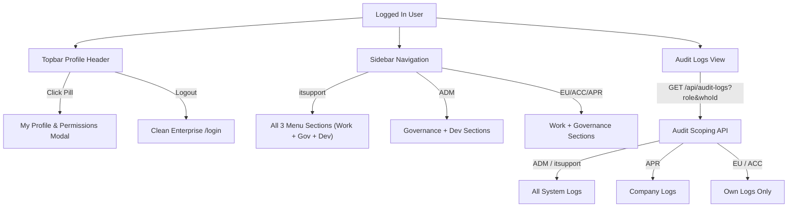

# Design Document: Production UI Cleanup, RBAC Design System Icons, Audit Log Scoping & IT Support Role

- **Date**: 2026-10-15
- **Status**: Approved
- **Scope**: Frontend & Ingestion/Audit API (`frontend/`)

---

## 1. Overview & Business Goals

This design addresses four production readiness requirements for the AIVA AP Review Portal:
1. **RBAC UI Design System Integration**: Replace all informal emojis (`👤`, `📋`, `🏢`, `🔒`, `🔄`) in permission and governance views with SVG-backed design system icons (`<Icon />`) and polished styling tokens matching the portal's design system.
2. **Audit Log Security Scoping**: Restrict log visibility so regular users (`EU`, `ACC`) see only their own activity logs, Accounting Lead (`APR`) sees logs for their assigned companies, while System Admin (`ADM`) and IT Support (`itsupport`) see all system logs.
3. **Login Page Production Cleanup**: Completely remove the yellow mock bar (`MockBar` with class `.lg-dev`), bypass buttons, and demo account selectors from `/login`.
4. **Topbar Production Profile & `itsupport` Role**:
   - Remove the demo role/user switcher dropdown (`#user-selector`) from the top-right corner.
   - Introduce the **Production Profile Header** with an interactive **"My Profile & Permissions"** modal allowing users to inspect their assigned role, companies, Oracle receiver accounts, and permitted capabilities.
   - Add the **`itsupport` (Support Admin)** role with full visibility across all 3 sidebar menu sections (Work, Governance, Dev/Testing tools) and cross-company document access.
   - Provide role-specific queue filters: Oracle Receiver account filtering for `EU`, and company chips for other roles.

---

## 2. Architecture & Component Changes

### 2.1 Role & Permissions Architecture (`src/types/auth.ts`, `src/mock/users.ts`)
- **RoleKey Type**:
  ```ts
  export type RoleKey = 'EU' | 'ACC' | 'APR' | 'ADM' | 'itsupport'
  ```
- **`itsupport` Configuration**:
  - Thai display name: `ฝ่ายสนับสนุนไอที (IT Support)`
  - Theme colors: `c: '#0D9488'`, `bg: '#CCFBF1'` (Teal tone)
  - Scope: `'all'` (Full visibility across all companies and receivers)
  - Permissions: Full suite of permissions including `['VIEW_CO', 'VIEW_OWN', 'DMS', 'CONFIRM', 'REVIEW', 'HOLD', 'REJECT', 'MANUAL_REVIEW', 'DUP_OVERRIDE', 'UNCONFIRM', 'POST', 'RETURN_FAILED', 'VIEW_AP', 'MAP', 'AUDIT']`
- **Default IT Support Demo User**:
  - `id`: `'u8'`
  - `n`: `'กิตติศักดิ์ ซัพพอร์ต'`
  - `email`: `'kittisak.s@aapico.com'`
  - `role`: `'itsupport'`
  - `co`: `['AH', 'AHT', 'AHP', 'AM']`
  - `unit`: `'IT Support & Infrastructure'`

### 2.2 Navigation & Sidebar Isolation (`src/components/layout/Sidebar.tsx`)
- Update `Sidebar` menu sections to recognize `itsupport`:
  - `isAdmOrSupport = currentUser.role === 'ADM' || currentUser.role === 'itsupport'`
  - `itsupport` displays all 3 menu sections:
    1. **งานหลัก**: คิวตรวจสอบ (`queue`) + ส่งเข้า AP Interface (`ap`)
    2. **การกำกับดูแล**: สิทธิ์และการเชื่อมบัญชี (`rbac`) + บันทึกการเข้าถึง (`audit`) + ตั้งค่า (`settings`)
    3. **เครื่องมือทดสอบและพัฒนา**: ชุดเอกสารทดสอบ (`cases`) + มาตรฐาน Payload (`std`) + Document Simulation (`sim`)
  - `ADM` continues to see Governance + Dev Tools.
  - `EU`, `ACC`, `APR` see Work + Governance (without Dev tools).

### 2.3 Topbar Profile & "My Profile & Permissions" Modal (`src/components/layout/Topbar.tsx`, `MyProfileModal.tsx`)
- **Topbar**:
  - Remove `<select id="user-selector">` completely.
  - Render an interactive **Profile Pill**:
    - Current user's full name (e.g. `สมศักดิ์ ใจดี`)
    - Colored role badge (e.g. `ผู้ใช้งาน (Receiver)` / `ฝ่ายสนับสนุนไอที (IT Support)`)
    - Info trigger button opening `MyProfileModal`
    - Logout button (`<Icon name="logout" />`)
- **My Profile Modal** (`src/components/layout/MyProfileModal.tsx`):
  - User details: Full Name, Entra ID / Email, Employee ID, Department.
  - Assigned scope: Company list (`AH, AHT, AHP, AM`) and Oracle Receiver accounts (for `EU`).
  - Permissions matrix: Grid of capabilities permitted for this user's role with descriptions and green checkmarks.

### 2.4 RBAC UI Redesign & Emoji Purge (`src/components/governance/RbacPage.tsx`)
- Replace emojis with `<Icon />` SVG components:
  - Tab 1: `<Icon name="user" size="sm" /> จัดการสิทธิ์ผู้ใช้งาน (Admin Grid)`
  - Tab 2: `<Icon name="layers" size="sm" /> Matrix สิทธิ์ตามบทบาท`
  - Tab 3: `<Icon name="building" size="sm" /> บริษัทและ ORG_ID`
  - Read-only hint: `<Icon name="lock" size="sm" /> มุมมองอ่านอย่างเดียว (เฉพาะผู้ดูแลระบบ IT เท่านั้นที่แก้ไขได้)`
  - Sync button: `<Icon name="refresh" size="sm" /> ซิงค์ข้อมูลจาก Oracle`
- Update table headers, chips, and modal headings with clean CSS tokens, removing any loose Unicode symbols or emojis.

### 2.5 Audit Log Scoping (`src/app/api/audit-logs/route.ts`, `src/components/governance/AuditPage.tsx`)
- **API Endpoint (`/api/audit-logs`)**:
  - Accepts query parameters: `?whoId=...&role=...&companies=...`
  - Scoping policy:
    1. `role === 'ADM' || role === 'itsupport'`: Returns all 100 most recent logs.
    2. `role === 'APR'`: Returns logs belonging to documents within their assigned company codes, plus their own logs.
    3. `role === 'EU' || role === 'ACC'`: Returns only logs where `whoId === currentUserId` (or `who === currentUserName`).
- **Frontend Page (`AuditPage.tsx`)**:
  - Passes user identity params to `/api/audit-logs`.
  - Applies a client-side filter fallback as defense-in-depth.

### 2.6 Login Page Cleanup (`src/features/login/LoginPage.tsx`)
- Remove the yellow `<MockBar />` rendering.
- Remove dev/mock disclaimers from the footer.
- The login form remains fully functional for Microsoft 365 SSO and internal LDAP credentials.

### 2.7 Role-specific Queue Filters (`src/components/queue/QueueToolbar.tsx`, `src/context/InvoiceContext.tsx`)
- For `EU` (Receiver):
  - Render an interactive Receiver account filter selector/chips (e.g., "ทุกบัญชี Receiver ของฉัน", specific receiver name) instead of static plain text.
- For other roles (`ACC`, `APR`, `itsupport`, `ADM`):
  - Maintain company filter chips (`ทุกบริษัท`, `AH`, `AHT`, `AHP`, `AM`). For `itsupport`, allow selecting all companies.

---

## 3. Data Flow & Security Model



---

## 4. Verification & Testing Strategy

1. **Unit & Integration Tests**:
   - `src/test/sidebarRole.test.tsx`: Test that `itsupport` sees all menus including dev tools and queue/ap, while `ADM` sees only gov/dev, and `EU` sees only work/gov.
   - `src/test/auditLogScoping.test.ts`: Verify `/api/audit-logs` scoping: EU sees only own logs, APR sees company logs, ADM/itsupport see all logs.
   - `src/test/loginPage.test.tsx`: Verify `/login` renders without yellow mock bar.
   - `src/test/rbacPageInteractive.test.tsx`: Verify RbacPage renders clean tabs without emojis and switches tabs correctly.
   - `src/test/topbarProfile.test.tsx`: Verify Topbar renders user name and role badge without `<select id="user-selector">`, and clicking profile opens `MyProfileModal`.
2. **Full Regression Suite**:
   - `npm test`: All 37+ Vitest test suites must pass clean (exit code 0).
   - `npx tsc --noEmit`: Strict TypeScript typecheck must pass with 0 errors.
   - `npm run build`: Next.js 15 production build must generate clean.
