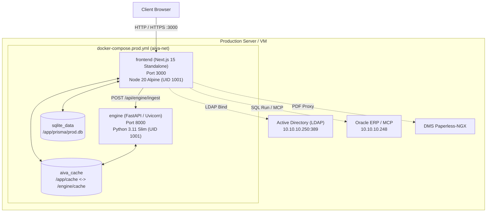

# Design Document: Production Docker Compose, Super Admin (SA) RBAC, Login Polish & Invoices v5 Dataset

- **Date**: 2026-10-16
- **Status**: Approved
- **Scope**: Entire Solution (`frontend/`, `engine/`, Docker & Deployment)

---

## 1. Overview & Business Goals

This design addresses six critical production-readiness requirements for the AIVA AP Review Portal:
1. **Production Docker Compose**: Deliver a complete, robust, turn-key `docker-compose.prod.yml` and multi-stage Dockerfiles (`Dockerfile.frontend`, `Dockerfile.engine`) running Frontend (Next.js 15 Standalone) and AIVA Engine (Python FastAPI) with SQLite and cache persistent volumes, healthchecks, and non-root security.
2. **Login Page Polish**: Ensure the small note/callout bar *"Portal ไม่เก็บ URL ของ DMS · ออกลิงก์ชั่วคราว 10 นาที พร้อมลายน้ำ เมื่อมีคนเปิดดู"* is 100% removed, while preserving the full 5-tab system explainer ("ระบบทำงานอย่างไร").
3. **Explainer Animation Speedup & Play Bugfix**: Fix the issue where clicking "เล่นอัตโนมัติ" (Play) or switching tabs freezes or does not animate due to mouse hover detection (`holdRef`), and double the animation playback speed for a modern, responsive feel.
4. **Strict Authentication Guard (No Default IT Support Login)**: Forbid auto-login or default login with IT Support or any account. Any unauthenticated visitor accessing `/` or internal routes must be redirected to `/login` immediately.
5. **Role Refactoring (`itsupport` -> `SA` Super Admin)**:
   - Establish that `itsupport` (`itsupport@aapico.com`) is an **Account**, not a Role name.
   - Refactor the role key to **`SA` (Super Admin)**.
   - In Table 6 (Matrix สิทธิ์ตามบทบาท): column header is **`SA`** (Tooltip / Title: *Super Admin*).
   - In Table 5 (Admin Grid): role dropdown includes **`SA — Super Admin`**, and administrators can assign `SA` to any user in the organization.
6. **Clean Oracle Accounts Slate**: Purge mock Oracle receiver accounts (`SOMSAK JAIDEE`, `WILAIWAN SRISUK`, `THANAKORN MANKONG`). Start with a clean mapping table where only real Oracle accounts are mapped via Admin Grid or synchronized directly from Oracle ERP.
7. **Production Invoice Dataset Upgrade**: Ingest the 125 real Engine result files from `temp/paperless_invoices_v5/` into the Portal database and default queue state, replacing old mock data.

---

## 2. Architecture & Components



---

## 3. Detailed Component Specifications

### 3.1 Production Docker Compose Architecture

#### `frontend/Dockerfile.frontend`
Multi-stage build:
- **Stage 1 (deps)**: `node:20-alpine`, installs dependencies with `npm ci`.
- **Stage 2 (builder)**: Runs `prisma generate`, `scripts/copy-pdfjs-worker.mjs`, and `npm run build` (with `output: 'standalone'` in `next.config.ts`).
- **Stage 3 (runner)**: Minimal `node:20-alpine`, runs as non-root `nodejs` (UID 1001), copies `.next/standalone`, `.next/static`, `public`, `prisma`, and `temp/paperless_invoices_v5`.
- **Entrypoint**: Automatically runs `npx prisma db push --skip-generate` to ensure SQLite schema is up-to-date in persistent volume, seeds from `paperless_invoices_v5` if DB is empty, then starts `node server.js`.

#### `engine/Dockerfile.engine`
- **Base**: `python:3.11-slim`.
- Installs system libraries for PyMuPDF (`libmupdf-dev`, etc.) if needed.
- Installs requirements from `engine/requirements.txt`.
- Non-root user `appuser` (UID 1001).
- Command: `python -m system_a.cli serve --host 0.0.0.0 --port 8000`.

#### `docker-compose.prod.yml`
- Root level orchestration file.
- Named volumes:
  - `sqlite_data`: Persistent storage for `/app/prisma/prod.db`.
  - `aiva_cache`: Shared downloads/scans cache between engine and frontend.
- Healthchecks on both services.
- `restart: unless-stopped`.
- Logging limits (`max-size: "20m"`, `max-file: "5"`).

---

### 3.2 Login Page Polish & Animation Speedup (Bugfix 3.1)

#### Removing DMS Watermark Callout Note
- Remove the yellow callout box containing `"Portal ไม่เก็บ URL ของ DMS · ออกลิงก์ชั่วคราว 10 นาที พร้อมลายน้ำ เมื่อมีคนเปิดดู"` from `FlowScene.tsx` and purge the `note` string from `src/features/login/data/explainer.ts`.
- Retain all 5 tabs and diagrams in `HowItWorks.tsx`.

#### Animation Speedup & Play Bugfix
- **Root Cause of Play Freeze**: `HowItWorks.tsx` had `onMouseEnter={() => (holdRef.current = true)}` on the outer `<section>`. When clicking the "เล่นอัตโนมัติ" button, the mouse remained on the button/panel, keeping `holdRef.current = true` and immediately returning from the 100ms interval loop.
- **Fix**:
  1. Remove aggressive section-level hover pause or explicitly ignore hover when auto-play is explicitly triggered.
  2. In `toggleAuto()`, reset `holdRef.current = false` and elapsed timers to immediately begin playing.
  3. Increase animation speeds:
     - `DWELL` per tab: Cut from 20-25s to **10-12s**.
     - `STEP_MS` per step: Cut from 3.3-3.5s to **1.6-1.8s**.
     - `RulesScene` step delay `T`: Cut from 460ms to **250ms**.
     - Accelerated CSS keyframe animations for laser lines and progress bars.

---

### 3.3 Route Guard & Strict Authentication

#### No Default IT Support Login
- In `src/context/AuthContext.tsx`:
  - `currentUser` initializes to `null` (unauthenticated) instead of defaulting to `USERS[0]`.
  - When no valid session is found in cookies or localStorage, access to protected routes (`/`, `/queue`, `/ap`, `/rbac`, `/audit`, etc.) redirects to `/login`.
- In `src/features/login/LoginPage.tsx` & `useLogin.ts`:
  - Username and password inputs are blank on load.
  - No auto-login or bypass buttons in production mode.

---

### 3.4 Super Admin (`SA`) Role Refactoring

#### Role System Refactoring
- **RoleKey Definition**:
  ```ts
  export type RoleKey = 'EU' | 'ACC' | 'APR' | 'ADM' | 'SA'
  ```
- **Role Attributes**:
  - Code: `'SA'`
  - Title: `'ผู้ดูแลระบบระดับสูง (Super Admin)'` / `'Super Admin'`
  - Scope: `'all'`
  - Permissions: Complete permission set (`VIEW_CO`, `VIEW_OWN`, `DMS`, `UPLOAD_NEW`, `CONFIRM`, `REVIEW`, `HOLD`, `REJECT`, `MANUAL_REVIEW`, `DUP_OVERRIDE`, `UNCONFIRM`, `POST`, `RETURN_FAILED`, `VIEW_AP`, `MAP`, `AUDIT`).
- **Table 6 (Matrix สิทธิ์ตามบทบาท)**:
  - Column header changes from `itsupport` to **`SA`** (Tooltip / Title: *Super Admin*).
- **Table 5 (Admin Grid - การจัดการสิทธิ์)**:
  - Role dropdown displays: `EU`, `ACC`, `APR`, `ADM`, **`SA — Super Admin`**.
  - Any user with `ADM` or `SA` can promote/assign `SA` to any user.
- **Account `itsupport` (`itsupport@aapico.com`)**:
  - Configured as a user account with role `SA`.

---

### 3.5 Purging Fake Oracle Accounts (Clean Slate)

- Remove hardcoded mock receiver names (`SOMSAK JAIDEE`, `WILAIWAN SRISUK`, `THANAKORN MANKONG`) from default initial mapping constants (`INITIAL_MAPS`).
- Start with an empty mapping table in production.
- Allow mappings to be added dynamically via:
  1. Admin Grid manual assignment (`AdUserSearchModal` / `PermissionExcelGrid`).
  2. Oracle ERP live sync (`/api/oracle/sync-companies` / MCP).

---

### 3.6 Ingestion of Real Invoice Dataset (`paperless_invoices_v5`)

- Ingest all 125 documents from `temp/paperless_invoices_v5/` into SQLite DB via `/api/engine/ingest`.
- Update `scripts/simulate-engine-push.ts` default directory to `temp/paperless_invoices_v5`.
- Update `INITIAL_DOCS` in `src/mock/initialDocs.ts` to reflect the 125 documents:
  - **Auto-pass**: 51
  - **Review**: 23
  - **Hold**: 12
  - **Manual Review**: 39
  - Total: 125 documents matching `summary.json`.

---

## 4. Verification & Testing Strategy

1. **Unit & Integration Tests**:
   - Update tests referencing `itsupport` role to expect `SA`.
   - Update tests for route guard and auth redirection.
   - Run `npm test` across all 37 test suites -> 100% Pass.
2. **TypeScript & Static Analysis**:
   - Run `npx tsc --noEmit` -> 0 errors.
3. **Next.js Standalone Build**:
   - Run `npm run build` -> clean standalone build created in `.next/standalone`.
4. **Docker Validation**:
   - Validate `docker-compose.prod.yml` syntax using `docker compose config` (if docker available) or dry-run validation.
   - Verify healthchecks and volume mount paths.
5. **UI & UX Verification**:
   - Verify `/login` has no DMS watermark banner.
   - Verify auto-play button works immediately on click without mouse hover interference, and animations run at 2x speed.
   - Verify `/` redirects unauthenticated users to `/login`.
   - Verify RBAC Matrix shows `SA` column.
   - Verify Queue displays 125 documents from `paperless_invoices_v5`.
