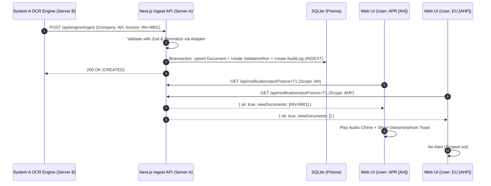

# Production Enhancements: DB Clean Scripts, RBAC Document Alerts, PDF Continuous Scroll, and Decoupled Microservices

**Date:** 2026-10-16  
**Status:** Approved by User  
**Scope:** Frontend Portal & System A OCR Engine Integration  

---

## 1. Overview & Objectives

This design addresses four key production enhancements for the AIVA Invoice Automation system:

1. **Database Clean Scripts in `package.json`**:
   - Provide safe, immediate commands to purge transaction data (`Document`, `ValidationRun`, `DocumentBBox`, `ApBatch`) and `AuditLog` from SQLite, while **strictly preserving** all user accounts, role definitions, and permission mappings (`User`, `UserCompany`, `UserReceiverMap`).
   - Add a targeted command to clear only `AuditLog`.
   - Prevent inadvertent sample auto-seeding when the system is deliberately wiped.

2. **RBAC-Scoped Document Alerts & Audit Logs**:
   - When a new invoice arrives via `POST /api/engine/ingest`, generate an immediate `AuditLog` entry.
   - Deliver real-time alerts (Glassmorphism Toast, audio chime, topbar pulse badge) exclusively to users who hold permission for that document's company/receiver according to RBAC.
   - Ensure the Audit Log viewer (`/api/audit-logs`) filters and reveals entries only to authorized users.

3. **PDF Continuous Multi-Page Scroll & Clean Default View**:
   - When opening a document's PDF, default to pure document rendering without clutter (`showEvidence = false`).
   - Display all document pages in a vertical continuous scroll container, allowing seamless mouse/trackpad scrolling from page 1 to page N.
   - Support synchronized toolbar page indicators via `IntersectionObserver`, jump-to-page navigation, and toggleable evidence bounding box overlays.

4. **Decoupled Backend Architecture (OCR Engine vs. Web Application)**:
   - Separate deployment configurations (`docker-compose.frontend.yml`, `docker-compose.engine.yml`, and unified compose with profiles) so that Frontend Portal and Python OCR Engine can run on completely separate servers/VMs or containers.
   - Maintain loose coupling via REST/Webhook contracts (`POST /api/engine/ingest` with Zod validation & normalization adapter), ensuring Web Portal functions 100% reliably even when the OCR Engine is offline or processing elsewhere.

---

## 2. Component Design & Specifications

### 2.1 Database Clean Scripts & Data Preservation

#### Scripts & CLI Commands
In [package.json](file:///c:/Users/wajeepradit.p/git/DMS_Invoice_Auto_mathing/frontend/package.json):
```json
{
  "scripts": {
    "db:clear:data": "tsx scripts/clear-database.ts --mode=data",
    "db:clear:logs": "tsx scripts/clear-database.ts --mode=logs"
  }
}
```

#### Script Implementation (`scripts/clear-database.ts`)
- **Mode `data` (Clean Transactions + Logs)**:
  - Executes a single Prisma transaction:
    ```typescript
    await prisma.$transaction([
      prisma.auditLog.deleteMany(),
      prisma.documentBBox.deleteMany(),
      prisma.validationRun.deleteMany(),
      prisma.apBatch.deleteMany(),
      prisma.document.deleteMany(),
    ])
    ```
  - **Preserved Tables**: `User`, `UserCompany`, `UserReceiverMap` are completely untouched.
  - Creates a marker file `.cleared` or sets `AIVA_DISABLE_AUTO_SEED=true` to prevent [autoSeedSample.ts](file:///c:/Users/wajeepradit.p/git/DMS_Invoice_Auto_mathing/frontend/src/lib/autoSeedSample.ts) from auto-repopulating sample invoices on subsequent dev/prod restarts.
- **Mode `logs` (Clean Logs Only)**:
  - Deletes only `AuditLog.deleteMany()`, leaving all invoices and user permissions intact.

---

### 2.2 RBAC-Scoped Alert Effect & Ingestion Audit Log Flow

#### 1. Ingestion Audit Log Generation
In [src/app/api/engine/ingest/route.ts](file:///c:/Users/wajeepradit.p/git/DMS_Invoice_Auto_mathing/frontend/src/app/api/engine/ingest/route.ts):
When a document is upserted, append an `AuditLog` row within the same transaction:
- `docId`: `doc.id` (e.g. `DMS-105`)
- `who`: `'OCR Matching Engine'`
- `role`: `'SYSTEM'`
- `act`: `'INGEST'`
- `detail`: `[${doc.companyCode}] เอกสารใหม่ ${doc.invoiceNum} (${doc.supplierName}) รับเข้าสู่ระบบสำเร็จ สถานะ: ${doc.status}`
- `createdAt`: `new Date()`

#### 2. Notification Polling Endpoint (`GET /api/notifications/poll`)
- Accepts query parameters:
  - `since`: ISO timestamp string (e.g. `2026-10-16T12:00:00.000Z`)
  - Authenticated session / headers to resolve user identity, role, and assigned companies.
- **RBAC Scoping Filter**:
  - `SA` / `ADM`: Queries all documents created after `since`.
  - `APR` / `ACC`: Queries documents where `companyCode IN (user.assignedCompanies)` created after `since`.
  - `EU`: Queries documents where `receiverName IN (user.assignedReceivers) OR companyCode IN (user.assignedCompanies)` created after `since`.
- Returns `{ ok: true, newDocuments: [...] }`.

#### 3. Client Alert Hook & UI Components
- Hook `useDocumentAlerts()`:
  - Polls `/api/notifications/poll` every 7-10 seconds.
  - Pauses polling when the browser tab is in background (`document.hidden`).
  - When new matching documents are returned:
    - **Audio Chime**: Triggers a pleasant synth audio chime using Web Audio API (with Topbar mute/unmute toggle persisted in `localStorage`).
    - **Glassmorphism Toast**: Displays an animated floating toast in the top-right corner with document ID, company tag, vendor, and a direct "ดูเอกสาร (View)" button.
    - **Queue & Bell Pulse**: Emits a subtle pulse animation on the Topbar notification bell and Queue menu item.
    - **Live Audit Log**: Triggers a refresh signal so the Audit Log table automatically highlights the new ingestion row.

---

### 2.3 PDF Continuous Multi-Page Scroll & Evidence Control

#### 1. Default Clean PDF View
In [EvidenceViewerDock.tsx](file:///c:/Users/wajeepradit.p/git/DMS_Invoice_Auto_mathing/frontend/src/components/evidence/EvidenceViewerDock.tsx):
- Default `showEvidence` state set to `false`:
  ```typescript
  const [showEvidence, setShowEvidence] = useState<boolean>(false)
  ```
- Opening a PDF displays only crisp, clean PDF pages without bounding box rectangles or exception badges obscuring text.
- Evidence highlights appear only when:
  1. The user explicitly toggles the "หลักฐาน" (Evidence) button in the Dock Toolbar.
  2. The user clicks on a validation check card in the Invoice Detail Pane (which sets `showEvidence = true` and auto-scrolls to the target page and coordinates).

#### 2. Continuous Multi-Page Vertical Rendering
- Update [PdfCanvasViewer.tsx](file:///c:/Users/wajeepradit.p/git/DMS_Invoice_Auto_mathing/frontend/src/features/pdf-viewer/components/PdfCanvasViewer.tsx):
  - Instead of a single canvas, render an array of page containers for `pageNum` 1 through `numPages`:
    ```tsx
    <div className="evd-continuous-container">
      {pages.map((p) => (
        <div key={p.pageNum} id={`pdf-page-${p.pageNum}`} className="evd-page-wrapper">
          <canvas ref={(el) => registerPageCanvas(p.pageNum, el)} />
          <BoundingBoxOverlay
            boxes={getBoxesForPage(p.pageNum)}
            pageSize={p.pageSize}
            visible={showEvidence}
          />
        </div>
      ))}
    </div>
    ```
  - **IntersectionObserver**: Watches each `.evd-page-wrapper` to determine the predominant page currently in viewport, updating the toolbar's `currentPage` state smoothly.
  - **Smooth Jump**: Toolbar Page Prev/Next and page selector execute `element.scrollIntoView({ behavior: 'smooth' })`.
  - **Single Scale Zoom & Fit-Width**: Calculates viewport width and renders each page canvas crisply matching device pixel ratio without horizontal scrollbars.

---

### 2.4 Decoupled Microservices Architecture (OCR Engine vs. Web App)

#### 1. Contract & Ingestion Decoupling
- **Engine Standard Schema**: Engine produces and pushes `aiva.system_a.result/3.0`.
- **Portal Normalization Adapter**: [engineToPortalAdapter.ts](file:///c:/Users/wajeepradit.p/git/DMS_Invoice_Auto_mathing/frontend/src/features/engine/adapters/engineToPortalAdapter.ts) normalizes and maps incoming payloads into the Portal domain model.
- **Idempotency & Resilience**: `POST /api/engine/ingest` verifies `validation_id` and `file_sha256`. Web Portal runs seamlessly standalone with its own persistent SQLite storage regardless of whether the Engine is online, offline, or hosted in a remote environment.

#### 2. Deployment Configurations
- `docker-compose.frontend.yml`: Standalone Next.js 15 Portal with SQLite volume and Paperless DMS cache.
- `docker-compose.engine.yml`: Standalone Python 3.11 Matching Engine with `PORTAL_CALLBACK_URL` pointing to the Portal.
- `docker-compose.prod.yml`: Multi-profile orchestration (`--profile frontend`, `--profile engine`, `--profile full`).

---

## 3. Data Flow & Sequence Diagram



---

## 4. Verification & Testing Strategy

1. **Database Clear Scripts**:
   - Run `npm run db:clear:data` on a populated test database.
   - Verify `Document`, `ValidationRun`, `DocumentBBox`, `ApBatch`, and `AuditLog` row counts equal 0.
   - Verify `User`, `UserCompany`, and `UserReceiverMap` row counts remain strictly unchanged.
   - Test `npm run db:clear:logs` and confirm only `AuditLog` is cleared.

2. **Alert & RBAC Scoping**:
   - Ingest a sample invoice for company `AH`.
   - Verify user with `AH` company scope receives notification alert and sees entry in `/api/audit-logs`.
   - Verify user with `AHP` only receives no notification and cannot see the log in `/api/audit-logs`.

3. **PDF Continuous Scroll & Default Evidence**:
   - Open a multi-page document (e.g. DMS-100, 5 pages).
   - Verify initial display shows clean PDF pages without bounding boxes.
   - Verify vertical scrolling seamlessly flows through all pages.
   - Verify clicking "หลักฐาน" shows bounding boxes across all pages.
   - Verify clicking a validation card jumps and scrolls smoothly to the target page and coordinates.

4. **Microservice Independence**:
   - Verify Next.js portal starts, builds, and runs cleanly with `SYSTEM_A_URL` offline.
   - Verify `docker-compose.frontend.yml` and `docker compose --profile frontend` config validity.
   - Verify full Vitest suite passes without regression.
