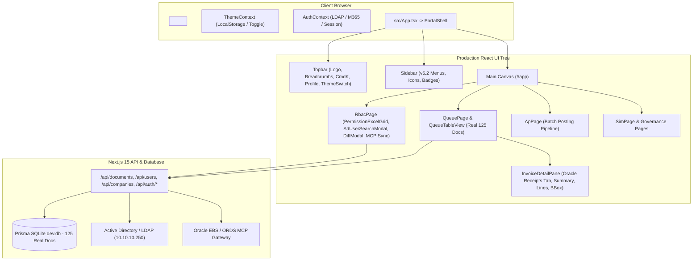

# Design Specification: Production React Architecture & v5.2 UI/UX Restoration

- **Date:** 2026-10-17
- **Status:** Approved
- **Author:** Antigravity & User

---

## 1. Context & Objectives

Following user feedback on the initial v5.2 migration, our previous attempt to drop in a static ChatGPT mock bundle (`temp/aiva-react`) inadvertently broke production workflows:
1. **Hydration Mismatch:** In `src/app/layout.tsx`, 17 `<link data-t="..." media="not all">` tags were mutated before React hydration by an inline script (`__aivaStyles`), triggering `A tree hydrated but some attributes of the server rendered HTML didn't match the client properties`.
2. **Missing Oracle Receipt Lines:** The Oracle Receipt lines tab (`doc.oracleReceiptLines`), variance diff calculation, and BBox evidence linking were missing because the static mock lacked that feature.
3. **Missing Permission Management UI:** The real Active Directory user search modal (`AdUserSearchModal`), `PermissionExcelGrid`, `SaveDiffModal`, and live Oracle MCP sync in `RbacPage.tsx` were replaced by a static read-only console.
4. **Broken Logo Rendering:** `src/logo.png` was not copied to `public/logo.png`, leaving `--logo-sm` and `--logo-big` undefined.
5. **Login Transition Issues:** The transition from `/login` into `/` was desynchronized because `temp/aiva-react` defaulted to hardcoded `u1` instead of reading the authenticated session from `AuthContext` and cookies.
6. **Fake Data vs Real 125 Documents:** The queue rendered hardcoded mock documents (`DMS-2026-000123`, etc.) and fake mock users (`u1`-`u8`) instead of the real 125 engine documents from `temp/paperless_invoices_v5`.

### Core Objective
**Retain 100% of the existing production business logic, database, and API integrations** (`PortalShell`, `InvoiceContext`, `AuthContext`, Prisma SQLite, Oracle Receipts, Active Directory search), while applying the refined visual styling, typography (`Bai Jamjuree`, `JetBrains Mono`), color palettes, and responsive grid layout from v5.2.

---

## 2. System Architecture

---

## 3. Detailed Component & Implementation Design

### 3.1 Resolving Hydration Mismatch & Theme Switching
- Remove the inline `<script>` in `src/app/layout.tsx` that mutates `media` attributes on `<link>` elements before React hydration.
- Load the base design tokens, CSS variables, and layout styles cleanly.
- Dark (`Graphite`) and Light (`Porcelain`) themes will be toggled cleanly via `data-theme="dark"` / `data-theme="light"` on `document.documentElement` managed by `ThemeContext`.
- Retain CSS rules for both dark and light modes using CSS variables (`--bg`, `--c`, `--t-blue`, `--t-ok`, etc.) so stylesheet link swapping is not required at runtime.

### 3.2 Logo Asset & Display Resolution
- Copy `src/logo.png` into `public/logo.png` and `public/assets/logo.png`.
- Define `--logo-sm: url('/logo.png')` and `--logo-big: url('/logo.png')` in CSS tokens.
- Ensure `.brand-tile .logo-mark` in Topbar, Sidebar, Splash Screen, and Login displays the authentic logo with correct aspect ratio (`975/625`), centering, and glow filter.

### 3.3 Restoring Oracle Receipt Lines in Detail View
- In `InvoiceDetailPane.tsx`:
  - Retain Tab 3: `{ k: 'receipts', label: 'ใบรับ Oracle', count: doc.oracleReceiptLines?.length || 0 }`.
  - When selected, render the Oracle Receipts pane:
    - Summary of total receipt amount vs invoice subtotal with variance diff.
    - Associated PO numbers chips.
    - Line-by-line table with PO Number, Line Number, Item Description, Quantity, Unit Price, Line Total, and Matching Status.
    - Clickable link to trigger BBox overlay highlighting on the PDF evidence viewer dock.

### 3.4 Restoring & Polishing the RBAC Permission Console (`RbacPage.tsx`)
- Keep the 4-tab interactive governance structure:
  1. **Tab 1: Permission Excel Grid:**
     - Interactive table of managed users, roles, and company checkboxes.
     - `+ เพิ่มผู้ใช้` button opening **`AdUserSearchModal`** (querying live `/api/ad/search`).
     - Action buttons: Delete user, revert draft changes.
     - Save button opening **`SaveDiffModal`** to review diffs before saving to `/api/users` and logging to `AuditLog`.
  2. **Tab 2: Role Permission Matrix:**
     - Matrix displaying permissions across SA, ADM, APR, ACC, EU.
  3. **Tab 3: Companies & ORG_ID Reference:**
     - 26 AAPICO corporate entities with instant search.
     - Interactive **"ซิงค์ข้อมูลจาก Oracle"** button calling `/api/oracle/sync-companies`.
  4. **Tab 4: User Inspector / Visibility Tester:**
     - Testing visibility and accessible documents per user role and company assignments.
- Polish all tabs with v5.2 design tokens (cards, sleek borders, hover states, and clear typography).

### 3.5 Real 125 Documents Pipeline (`temp/paperless_invoices_v5`)
- Confirm that `prisma/dev.db` and `src/mock/initialDocs.ts` are populated with the 125 real documents (51 Auto-pass, 23 Review, 12 Hold, 39 Manual Review).
- Ensure `InvoiceContext.tsx` fetches from `/api/documents?include=boxes` and falls back cleanly to `initialDocs.ts`.
- Purge fake mock users (`u1`-`u8`) and fake mock documents from runtime constants.

### 3.6 Login Transition & Authentication Flow
- When a user logs in via `/login` (LDAP, Microsoft 365, or Instant Bypass):
  - Store session in cookie `aiva.session.token` and `localStorage` profile.
  - Redirect cleanly via `router.replace(redirectTo || '/queue')`.
  - In `AuthContext.tsx`, restore the real user session from cookie / `/api/auth/me` / localStorage, defaulting to `ANONYMOUS_USER` if unauthenticated.
  - In `PortalShell`, protect private routes and redirect unauthenticated visitors to `/login`.

---

## 4. Verification & Validation Strategy

1. **Hydration Check:** Load `http://localhost:3000/` and verify zero hydration mismatch errors in the browser console.
2. **Oracle Receipts Check:** Select an invoice in `/queue` with receipt lines and verify the `ใบรับ Oracle` tab displays lines and variance correctly.
3. **RBAC Add-User & Search Check:** Open `/rbac`, click `+ เพิ่มผู้ใช้`, search an AD employee, edit roles, and verify Save Diff Modal.
4. **Logo Check:** Verify `public/logo.png` renders sharply in Sidebar and Topbar.
5. **Real Documents Check:** Verify exactly 125 documents exist in the database and match Engine distribution (51 Auto-pass, 23 Review, 12 Hold, 39 Manual Review).
6. **Regression Tests:** All 60+ Vitest test suites must pass (`npx vitest run`).
7. **Typecheck & Build:** `npx tsc --noEmit` and `npm run build` must complete with exit 0.
