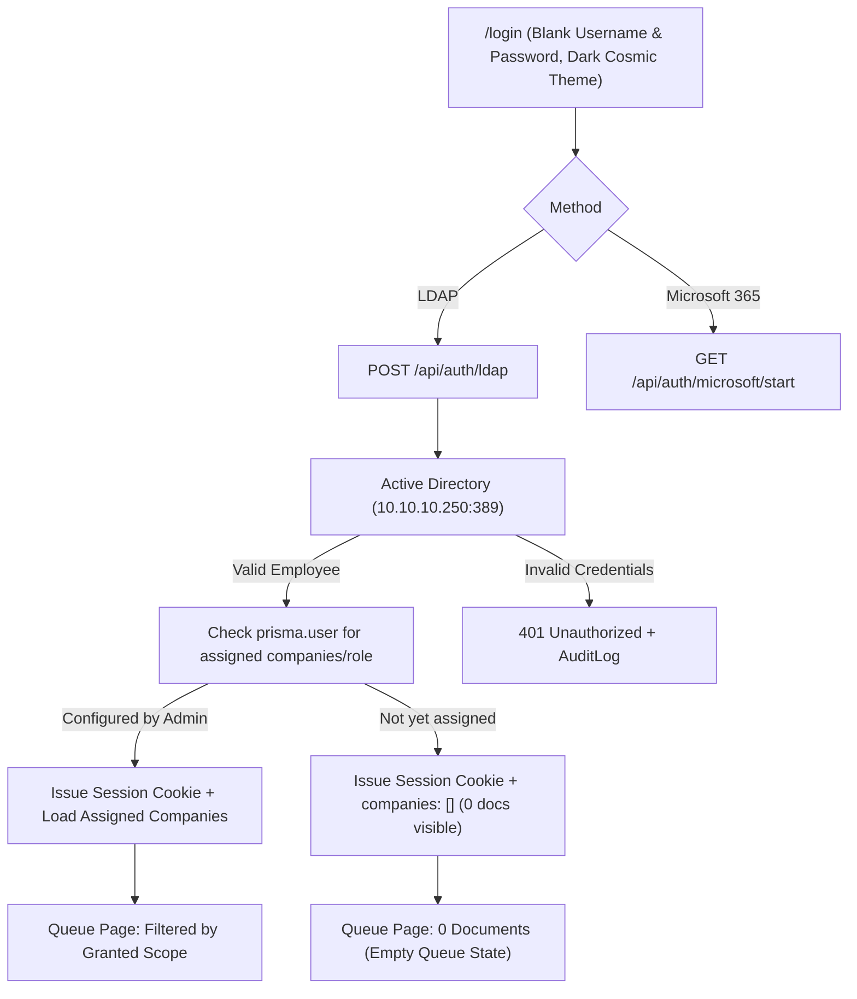

# Design Document: Login Theme, React Hook Integrity, and Strict Zero-Trust RBAC

**Date:** 2026-10-18  
**Status:** Approved  
**Author:** Pair Programming Agent & User  

---

## 1. Problem Statement & User Requirements

1. **Dark Mode & Hydration Mismatch:**
   - On SSR, the login page rendered `aria-checked="false"` and dark mode titles, but on the client it hydrated `aria-checked={true}` because `ThemeContext` initialized directly from `localStorage.getItem('aiva.theme')`.
   - The user experienced a jarring white/light login page on load.
   - Requirement: The login screen must default to the authentic Dark Cosmic Theme (`--lg-bg: #0d0d10`) without any SSR hydration mismatches, while allowing users to toggle between Dark and Light mode cleanly.

2. **Login Account & Fake User Elimination:**
   - The user strictly requested that the default login must **NOT** be IT Support (`itsupport`), and that the login screen must start with a clean blank form.
   - The user explicitly requested to **purge all fake/mock users** (`u1`..`u8`, fake `itsupport` roster) from the active authentication system.
   - Authentication must use genuine Active Directory LDAP (`10.10.10.250:389`), Microsoft 365 OAuth, and genuine users stored in SQLite (`prisma.user`, e.g. `wajeepradit.p`).

3. **Strict Zero-Trust RBAC Scoping:**
   - User policy requirement: *"user ต้องมีการจัดการสิทธิ์การเสมอ หากไม่มีการจัดการสิทธิ์เเล้ว login จะไมเห็นรายการอะไร"*
   - When a newly authenticated corporate user logs in, if an Admin has not explicitly assigned them company codes or Oracle receiver accounts in the RBAC console, their assigned companies and receivers must be empty (`[]`).
   - Consequently, `scopeCheck` ensures the user sees **0 documents** in the queue until an Admin explicitly grants access.

4. **React Hook Order Violation in `PortalShell.tsx`:**
   - Next.js red error screen reported: *"React has detected a change in the order of Hooks called by PortalShell."*
   - Root cause: An early conditional return `if (!isAuthenticated) return (...)` at line 53 appeared before `useEffect` keyboard listener at line 100.
   - Requirement: Move all conditional returns after all hook declarations to strictly obey React's Rules of Hooks.

---

## 2. Architecture & Data Flow

---

## 3. Detailed Component Designs

### 3.1 `ThemeContext.tsx` & `ThemeSwitcher.tsx`
- **Guaranteed SSR Parity:** Default `theme` state is initialized to `'dark'` on both server and client during initial render.
- **Client Synchronization:** Synchronize `theme` from `localStorage` within `useEffect` after mount, completely avoiding `aria-checked` and `title` hydration mismatch errors.
- **Visuals:** `#lg` background maintains `--lg-bg: #0d0d10` in dark mode with smooth CSS view transition to `--lg-bg: #eef2f9` in light mode.

### 3.2 Authentication & User Model (`/api/auth/ldap`, `adAuth.ts`, `autoSeedSample.ts`)
- Remove hardcoded mock users (`u1`..`u8`, `itsupport` roster).
- Stop auto-seeding fake `itsupport` user into SQLite database in `autoSeedSample.ts`.
- When an AD user authenticates successfully:
  - If existing in `prisma.user` with assigned companies -> use database role and companies.
  - If new user or not assigned -> persist basic identity in `prisma.user` with role `EU`, `companies: []`, and `receivers: []`.
  - Zero-Trust: Users without assigned companies see 0 documents in the queue.

### 3.3 `PortalShell.tsx` Hook Integrity
- Reorder hooks so all `useContext`, `useState`, `useEffect`, and `useCallback` invocations execute unconditionally before any conditional return.
- Place `if (!isAuthenticated)` immediately prior to the JSX render.

### 3.4 Explainer Panel (Right Side of Login)
- Tab 4 (`RoleScene.tsx`): Update to describe role archetypes (EU = Receiver, ACC = AP Accountant, APR = Approver, ADM = IT Admin) without referencing fake employee identities.

---

## 4. Verification Plan

1. **Unit Tests (Vitest):**
   - Test `ThemeSwitcher` for SSR and hydration parity without mismatch warnings.
   - Test `PortalShell` hook call stability during auth state transitions.
   - Test LDAP route and Zero-Trust company assignment (unassigned user gets 0 documents).
2. **Type Check:**
   - `npx tsc --noEmit` must pass with 0 errors.
3. **End-to-End Build:**
   - `npm run build` must compile clean.
4. **Browser Verification:**
   - Verify `http://localhost:3000/login` loads cleanly in Dark mode with blank inputs, no hydration errors, and functional theme switcher.
