# Architecture Design: React + Express Adapter Service Migration

**Document Date:** 2026-10-19  
**Status:** Approved  
**Author:** AI Pair Programmer & System Engineering Team  
**Scope:** `frontend/` Web Application Architecture Evolution  

---

## 1. Executive Summary & Problem Statement

Currently, the AIVA Invoice Matching web application is packaged as a **Next.js 15** application. While Next.js provides built-in API route handlers, it introduces significant friction for this internal enterprise portal:
1. **Unnecessary SSR / Hydration Complexity:** The entire portal (`QueuePage`, `InvoiceDetailPane`, `EvidenceViewerDock`, `RbacPage`) is an internal dashboard behind authentication. It uses 100% Client Components (`'use client'`) with `useState`, `useEffect`, and DOM manipulation (e.g., PDF.js canvas, bounding box overlays). Next.js SSR causes server-side errors with `DOMMatrix` and browser globals.
2. **Build Times & Tooling Overhead:** Running `next build` is heavy (~150MB+ memory, standalone tracing, route generation) and slow compared to native client build tools.
3. **Decoupling Need:** The team desires a **Pure React** frontend (fast Hot Module Replacement via Vite, pure SPA execution) paired with a lightweight **Backend Adapter Service** running in the background to interface with SQLite, Active Directory (LDAP), DMS Paperless, and Python Engine webhooks.

This design outlines the architecture of the **Integrated Express Host**:
- **Frontend:** React 19 + Vite 6 Single Page Application (SPA).
- **Backend:** Express.js + TypeScript Adapter Service managing Prisma SQLite, LDAP authentication, Webhook ingestion, and Paperless streaming proxy.
- **Workflow:** Single command `npm run dev` for seamless development, and a unified single-port production server.

---

## 2. System Architecture & Component Diagram

```mermaid
graph TD
    subgraph Browser ["Client Surface (Browser)"]
        ReactApp["React 19 SPA (Vite)"]
        PdfViewer["PDF.js Canvas Viewer"]
        ReactApp --> PdfViewer
    end

    subgraph HostServer ["Host Machine / Container"]
        subgraph DevMode ["Dev Mode (:3000)"]
            ViteDev["Vite Dev Server (:3000)"]
            ViteProxy["Vite Reverse Proxy (/api)"]
            ViteDev --> ViteProxy
        end

        subgraph BackendAdapter ["Express Adapter Service (:3001 dev / :3000 prod)"]
            ExpressServer["Express HTTP Server"]
            AuthRoutes["/api/auth (LDAP & Cookie Session)"]
            DocRoutes["/api/documents (List, Detail, Actions)"]
            PdfProxyRoute["/api/documents/:id/pdf (DMS Proxy)"]
            IngestRoute["/api/engine/ingest (Webhook Ingestion)"]
            BatchRoutes["/api/ap/batches (Oracle Staging)"]
            UserRoutes["/api/users & /api/ad/search (RBAC)"]
            AuditRoutes["/api/audit-logs (Security Scoped)"]
            HealthRoute["/api/health (Service Preflight)"]
            
            ExpressServer --> AuthRoutes
            ExpressServer --> DocRoutes
            ExpressServer --> PdfProxyRoute
            ExpressServer --> IngestRoute
            ExpressServer --> BatchRoutes
            ExpressServer --> UserRoutes
            ExpressServer --> AuditRoutes
            ExpressServer --> HealthRoute
        end

        subgraph Database ["Persistence Layer"]
            PrismaClient["Prisma ORM Client"]
            SQLiteDB[("SQLite Database (dev.db)")]
            PrismaClient --> SQLiteDB
        end
    end

    subgraph ExternalSystems ["External Enterprise Infrastructure"]
        LDAPServer["Active Directory (LDAP :389)"]
        PaperlessDMS["Paperless DMS REST API"]
        PythonEngine["Python Invoice Matching Engine v5.5"]
        OracleERP["Oracle ERP / ORDS MCP"]
    end

    ReactApp -- "fetch('/api/...')" --> ViteProxy
    ViteProxy -- "HTTP Proxy" --> ExpressServer
    BackendAdapter --> PrismaClient
    AuthRoutes -- "ldapts bind" --> LDAPServer
    PdfProxyRoute -- "streaming proxy" --> PaperlessDMS
    PythonEngine -- "POST webhook JSON" --> IngestRoute
    BatchRoutes -.-> OracleERP
```



---

## 3. Directory Layout

The workspace `frontend/` directory is organized into two distinct functional boundaries:

```
frontend/
├── index.html                       # Vite HTML entrypoint (<div id="root"></div>)
├── vite.config.ts                   # Vite configuration with /api proxy to :3001
├── tsconfig.json                    # Shared base TypeScript configuration
├── tsconfig.node.json               # Node/Server TypeScript configuration
├── package.json                     # Unified dependencies and scripts
│
├── src/                             # === FRONTEND (React 19 SPA) ===
│   ├── main.tsx                     # React root mount entrypoint
│   ├── App.tsx                      # PortalShell, navigation state & routing guard
│   ├── components/
│   │   ├── evidence/                # EvidenceViewerDock, PdfCanvasViewer, overlays
│   │   ├── governance/              # ApPage, AuditPage, CasesPage, RbacPage, etc.
│   │   ├── layout/                  # Topbar, Sidebar, Modal, Toast
│   │   └── queue/                   # QueuePage, InvoiceDetailPane, QueueTable
│   ├── context/                     # AuthContext, InvoiceContext, ToastModalContext
│   ├── features/
│   │   ├── login/                   # LoginForm, LoginPage, M365/LDAP tabs, explainer
│   │   └── pdf-viewer/              # Validation categories, coordinates
│   ├── lib/                         # Client-side utility functions & formatters
│   ├── mock/                        # Mock data fixtures & test references
│   ├── styles/                      # Pure Vanilla CSS stylesheets
│   └── types/                       # Shared Domain TypeScript contracts
│
├── server/                          # === BACKEND ADAPTER SERVICE (Express) ===
│   ├── index.ts                     # Express entrypoint, bootstrap & health check
│   ├── routes/                      # Modular Domain Route Handlers
│   │   ├── auth.ts                  # LDAP authentication & /api/auth/me session
│   │   ├── documents.ts             # Invoices list, actions mutation state machine
│   │   ├── pdfProxy.ts              # Paperless DMS streaming proxy with cache
│   │   ├── engineIngest.ts          # Python Engine result-3.0 webhook receiver
│   │   ├── apBatches.ts             # Oracle AP staging & callback webhook
│   │   ├── users.ts                 # User management & AD search (/api/ad/search)
│   │   ├── auditLogs.ts             # Scoped audit logging
│   │   ├── oracleSync.ts            # Oracle MCP company sync
│   │   └── health.ts                # System preflight healthcheck endpoint
│   ├── middleware/
│   │   ├── session.ts               # Cookie & Header session parsing
│   │   └── errorHandler.ts          # Centralized error & validation handling
│   └── lib/                         # Server singletons (Prisma, LDAP, AutoSeed)
│
└── prisma/                          # === DATABASE ===
    ├── schema.prisma                # Database models (Document, ValidationRun, etc.)
    └── dev.db                       # SQLite file (persistent storage)
```

---

## 4. Backend Adapter Service Specification

### 4.1 Route Migration Map
All 16 Next.js route handlers in `src/app/api/` map 1:1 to Express routes:

| Route Path | Method | Express Controller | Responsibility |
|---|---|---|---|
| `/api/auth/ldap` | POST | `server/routes/auth.ts` | Authenticates with AD via `ldapts`, returns user & sets cookie |
| `/api/auth/me` | GET | `server/routes/auth.ts` | Resolves user identity from cookie or header |
| `/api/auth/microsoft/start` | GET | `server/routes/auth.ts` | Microsoft 365 OAuth initiation |
| `/api/documents` | GET | `server/routes/documents.ts` | Fetches documents list with bounding boxes & filters |
| `/api/documents/:id` | GET | `server/routes/documents.ts` | Fetches single document details |
| `/api/documents/:id/actions` | POST | `server/routes/documents.ts` | Workflow state transitions (Confirm, Reject, Hold, Return) |
| `/api/documents/:id/pdf` | GET | `server/routes/pdfProxy.ts` | Streams PDF from Paperless DMS or fallback cache |
| `/api/engine/ingest` | POST | `server/routes/engineIngest.ts` | Webhook ingestion with Zod contract & idempotency check |
| `/api/ap/batches` | GET, POST | `server/routes/apBatches.ts` | Oracle AP batch creation & staging list |
| `/api/ap/batches/:id/callback` | POST | `server/routes/apBatches.ts` | Oracle AP payment/import completion callback |
| `/api/users` | GET, POST | `server/routes/users.ts` | RBAC user management & permissions persistence |
| `/api/ad/search` | GET | `server/routes/users.ts` | Queries Active Directory for employees |
| `/api/audit-logs` | GET | `server/routes/auditLogs.ts` | Identity-scoped audit log retrieval |
| `/api/oracle/sync-companies` | POST | `server/routes/oracleSync.ts` | Syncs company & org IDs from Oracle ORDS MCP |
| `/api/health` | GET | `server/routes/health.ts` | Checks DB, LDAP, DMS, and Engine availability |

### 4.2 Webhook Normalization Contract
`POST /api/engine/ingest` preserves the rigorous 4-stage pipeline:
1. **Contract Validation:** Zod guard against `aiva.system_a.result/3.0`.
2. **Idempotency Guard:** `validation_id` + `file_sha256` matching to prevent duplicate runs.
3. **Data Normalization:** `transformValidatedEngineResult` converts decimal strings, resolves company tax IDs, maps 4-step progress, and formats stable BBox keys.
4. **Prisma Atomic Persistence:** Saves `Document` and `ValidationRun` in a single transaction.

---

## 5. Frontend Client Specification

### 5.1 Vite Configuration (`vite.config.ts`)
```ts
import { defineConfig } from 'vite'
import react from '@vitejs/plugin-react'

export default defineConfig({
  plugins: [react()],
  server: {
    port: 3000,
    proxy: {
      '/api': {
        target: 'http://localhost:3001',
        changeOrigin: true,
      },
    },
  },
  build: {
    outDir: 'dist',
    emptyOutDir: true,
  },
})
```

### 5.2 Single Page Routing & View Guards
- `src/App.tsx` acts as the root orchestrator:
  - If `!isAuthenticated`, renders `<LoginPage />` directly within the SPA (no page reload).
  - If URL matches `/viewer/:id`, renders `<StandaloneBBoxViewer />`.
  - Otherwise, renders `<PortalShell />` with tab navigation (`queue`, `cases`, `ap`, `rbac`, `audit`, `settings`).

---

## 6. Execution & Operational Workflow

### 6.1 Package Scripts (`package.json`)
```json
{
  "scripts": {
    "dev": "concurrently -k -p \"[{name}]\" -n \"web,api\" -c \"cyan,green\" \"vite\" \"tsx watch server/index.ts\"",
    "build": "vite build && tsc -p server/tsconfig.json",
    "start": "node dist-server/index.js",
    "test": "vitest run",
    "typecheck": "tsc --noEmit",
    "seed:engine": "tsx scripts/simulate-engine-push.ts",
    "seed:v5": "tsx scripts/seed-invoices-v5.ts"
  }
}
```

### 6.2 Production Deployment
In production:
1. `npm run build` generates static frontend assets in `frontend/dist/` and transpiles `server/` into `dist-server/`.
2. `node dist-server/index.js` launches the Express server on port `3000`.
3. Express serves static assets from `dist/` for web requests and handles `/api/*` requests in the same process.
4. Dockerfile is simplified: multi-stage build without Next.js standalone tracing quirks.

---

## 7. Verification & Regression Plan

Before completion, the system must verify:
1. **Full Vitest Suite:** All 42 existing test files pass (256+ tests).
2. **TypeScript Compilation:** Zero errors across client and server (`tsc --noEmit`).
3. **Live API Integration:**
   - Active Directory LDAP login succeeds.
   - SQLite queries retrieve 125 documents.
   - `POST /api/engine/ingest` normalizes and stores incoming payloads.
   - PDF streaming proxy serves Paperless documents.
4. **Engine Parity:** `cd engine && python -m pytest -q` passes 263 tests without disruption.
